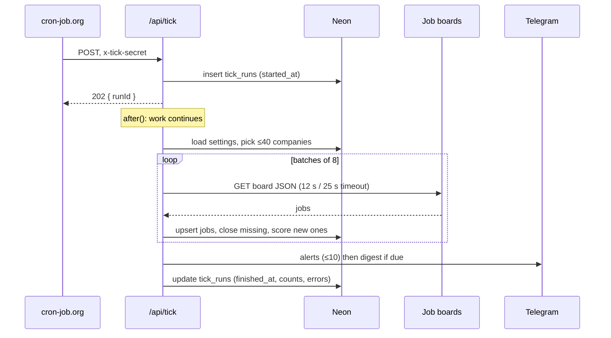
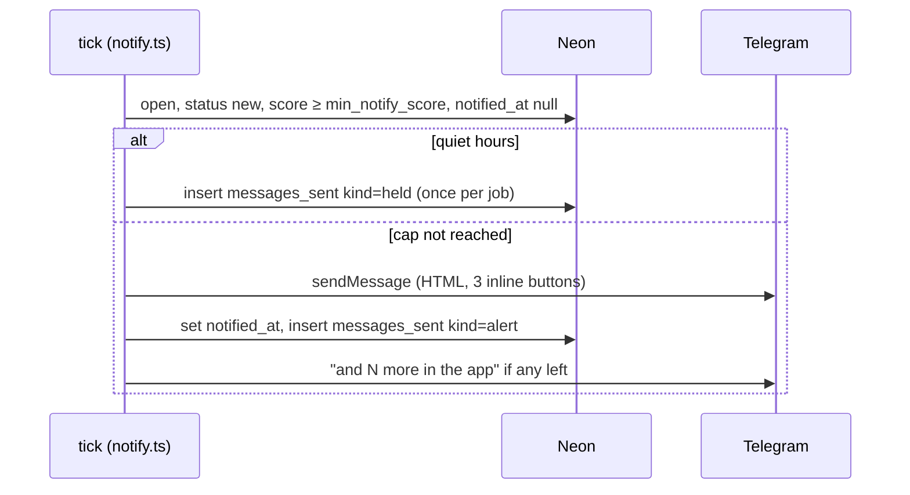
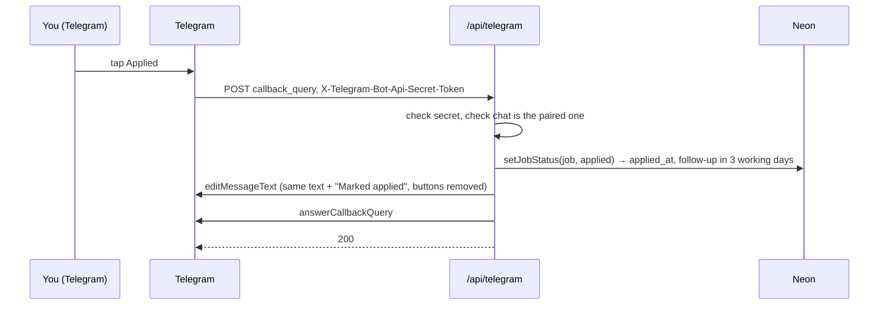
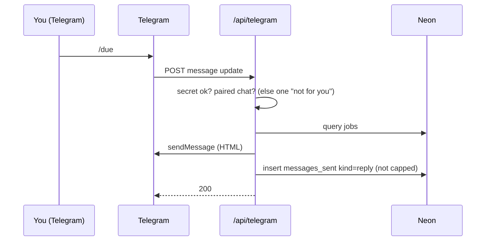
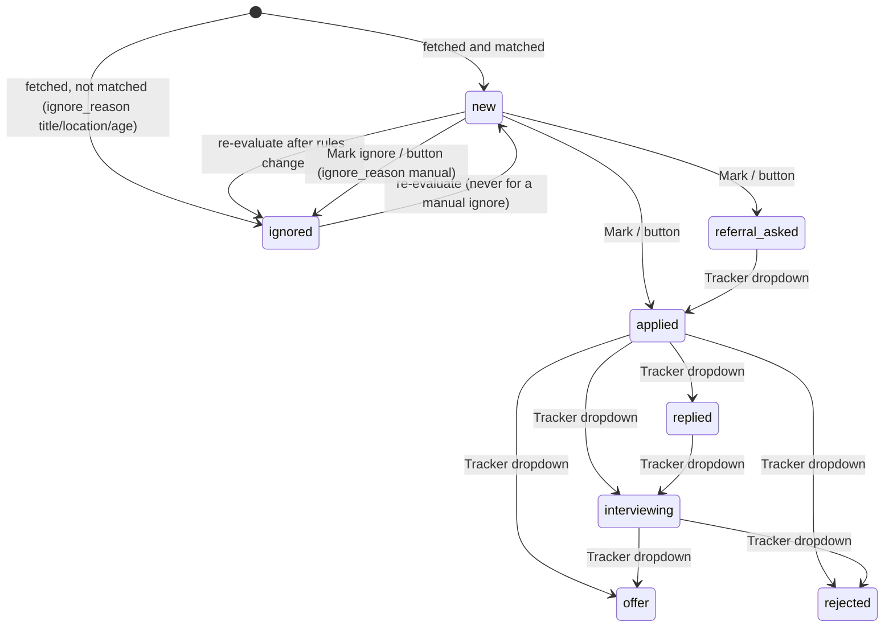

# Architecture

## What runs where

| Piece | Where | Role |
| --- | --- | --- |
| Next.js app (App Router, `src/`) | Vercel Hobby | The three screens, the login gate, `/api/tick`, `/api/tick/latest`, `/api/telegram`. Every page is server-rendered on demand. |
| Postgres | Neon free tier | One database shared by local scripts and production. Drizzle ORM over the Neon HTTP driver. |
| Telegram bot | Telegram servers, delivering to `/api/telegram` by webhook | Alerts, digest, commands, inline buttons. Locally it long-polls instead (`pnpm bot:dev`). |
| Scheduler | cron-job.org | POSTs `/api/tick` once an hour with the `x-tick-secret` header. |
| You | Phone or laptop browser, Telegram | The only user. The passcode cookie lasts 30 days. |

There is no queue, no background worker and no second service. Everything the tick does
happens inside one Vercel function invocation, which answers at once and keeps working inside
`after()` for up to 60 seconds.

## Request flows

### A tick

### An alert

### A button press

### A command

## Data model

| Table | One line |
| --- | --- |
| `companies` | A board to watch: name, ats (greenhouse, lever, ashby), slug, priority 1–3, active, failure count and last-fetch status/error/time. Unique on (ats, slug). |
| `jobs` | Every posting ever seen, matched or not: identity (source, external_id), title, location, is_remote, urls, posted_at, first/last seen, is_open, description text, score, matched keywords, location_match, status, ignore_reason, tracker fields (applied_at, referrer, notes, next action and date), notified_at. |
| `settings` | Single row id 1: matching lists and switches, max_age_days, min_notify_score, telegram_chat_id, quiet hours, digest time, the my_* template fields. |
| `tick_runs` | One row per tick: started/finished, companies fetched, jobs new, jobs notified, errors text. |
| `messages_sent` | One row per Telegram message to the paired chat (alert, digest, reply) or per held alert; backs the daily cap, the digest-sent-today check and the hold. |

Enums: `ats`, `fetch_status` (ok, error), `location_match` (explicit, remote, unknown, none),
`ignore_reason` (title, location, age, manual), `job_status`, `message_kind` (alert, digest,
reply, held).

## Job status transitions

Rules behind the arrows: the first move to `applied` stamps `applied_at` and sets next action
"follow up" three working days out (IST). A manual ignore is remembered as
`ignore_reason = manual` so re-evaluation never flips it back. The Tracker dropdown offers every
status except `new` and `ignored`, so any arrow among the actionable statuses is allowed; the
diagram shows the usual path. Jobs you have acted on are never touched by re-evaluation.

## Map of src/

| Path | What it does |
| --- | --- |
| `src/proxy.ts` | The request gate (Next 16 name for middleware). Everything needs the session cookie except `/login`, `/api/telegram` and `/api/tick*`. |
| `src/app/login/` | Passcode page and its server action; constant-time compare, HMAC cookie. |
| `src/app/(app)/layout.tsx` | Shell with the Feed / Tracker / Settings nav and the toast provider. All pages are dynamic. |
| `src/app/(app)/page.tsx` | Feed: views new, applied, referral, all open, older matches; `?job=<id>` pins and highlights one card. |
| `src/app/(app)/jobs/actions.ts` | Server actions for status changes and inline Tracker edits (Zod-validated). |
| `src/app/(app)/tracker/page.tsx` | Tracker table and funnel strip. |
| `src/app/(app)/settings/` | Settings page and its actions: companies, detect/add, test fetch, matching rules, profile, run tick, re-evaluate. |
| `src/app/api/tick/route.ts` | Secured tick trigger: inserts the run row, responds 202, runs the tick in `after()`. |
| `src/app/api/tick/latest/route.ts` | Returns the latest `tick_runs` row behind the same secret. |
| `src/app/api/telegram/route.ts` | Webhook: secret header check, then grammY. Always answers 200 after the check so Telegram does not retry forever. |
| `src/bot/index.ts` | The grammY bot: pairing gate, commands, callback buttons, command registration. |
| `src/bot/api.ts` | A bare API client for outbound sends from the tick. |
| `src/components/` | UI: feed card, tracker row and funnel, settings forms, menu, toast, nav, shared class strings. |
| `src/content/templates.ts` | The three outreach templates and the placeholder filler. |
| `src/db/schema.ts`, `src/db/index.ts` | Drizzle schema (all tables and enums) and the Neon client. Migrations live in `drizzle/`. |
| `src/lib/auth.ts` | Cookie signing and verification, passcode check. |
| `src/lib/match.ts` | Pure matching and scoring. No I/O. See [scoring.md](scoring.md). |
| `src/lib/tick.ts` | Company selection, fetching in batches, upserts, closing, scoring, the Telegram step, the run row. |
| `src/lib/notify.ts` | Alerts and the digest: eligibility, quiet hours, cap, formatting. |
| `src/lib/messaging.ts` | Send budget, cap counting, quiet-hour math, HTML escaping, chat id masking. |
| `src/lib/reevaluate.ts` | Re-scores open jobs from the last 30 days in batches of 200. |
| `src/lib/jobs.ts`, `src/lib/job-status.ts` | Status transition logic (server) and the pure status labels (safe for client code). |
| `src/lib/detect.ts` | Slug guessing and probing all three ATSes. |
| `src/lib/dates.ts` | IST helpers, working-day arithmetic, "ago" formatting. |
| `src/lib/links.ts`, `src/lib/stats.ts`, `src/lib/settings.ts`, `src/lib/html.ts` | LinkedIn search URLs, funnel counts, settings loader, HTML-to-text. |
| `src/sources/` | One adapter per ATS plus the shared HTTP client (timeouts, user agent) and the `NormalizedJob` type. |
| `scripts/` | CLI entry points run with `node --env-file=.env.local`: seed, detect/add companies, tick dry/local/prod, reevaluate, bot dev/webhook. `scripts/dev/bot-test.ts` is a verification harness with Telegram mocked. |
